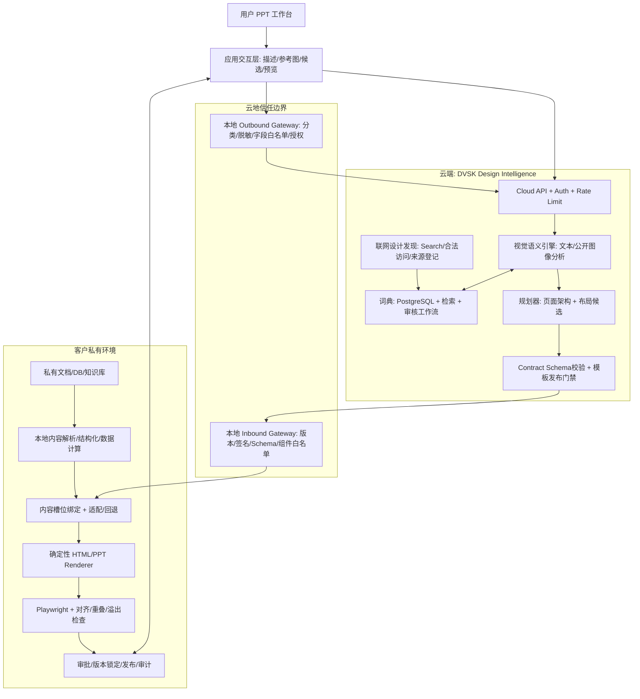
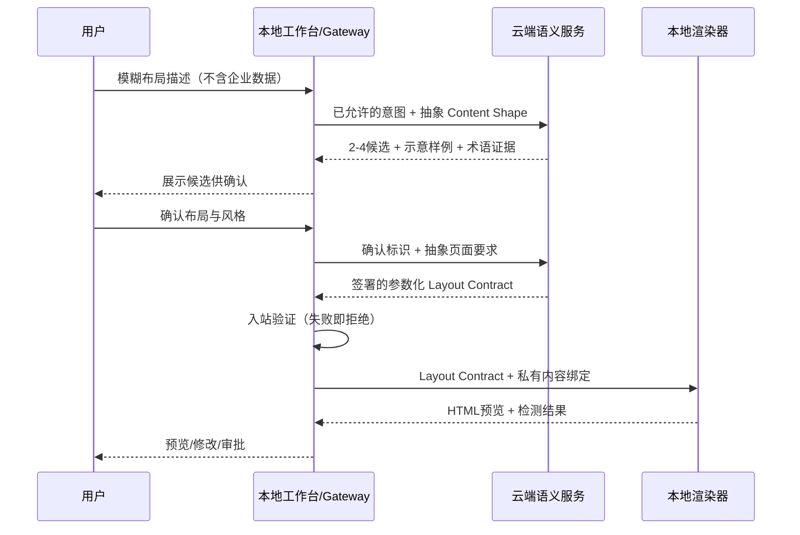

# DVSK Hybrid v0.3 — 架构与数据流（评审草案）

## 1. 原则
- 云端：联网视觉发现、公开图片解构、专业术语解释、动态词典、布局规划、通用 PPT 架构设计。
- 企业本地：私有内容读取/加工、真实数值计算、数据填充、HTML/CSS/SVG 渲染、审计、发布。
- 越过边界只传**经过许可的 Content Shape Contract** 和设计意图；云端返回仅数据化、可验证的设计 Contract，不返回待执行任意脚本。
- 云端知识/搜索文本视为不可信；模板审核、组件白名单、签名和出站门禁必须与模型分离。

## 2. 逻辑架构图

**关键提醒**：应用交互层可以部署于客户本地，或由云端提供无私有数据的设计 UI；无论位置如何，涉及真实文案/数据时应在客户本地处理。云端的“架构设计”只输出抽象语义结构和占位槽位，不做企业真实内容分析。

## 3. 组件职责边界
L1 工作台：描述输入、视觉样例对照、候选确认、版本差异、预览；不持有跨租户私有内容。
L2 云端视觉理解：识别几何/层次/对齐/构图/风格；输出观察依据、候选术语与不确定性。
L3 云端知识：来源检索、词条合并/去重、授权记录、样例缩略、编辑审核、版本发布。
L4 云端规划：选择可执行布局 family、页级叙事骨架、内容形状槽位、约束和安全 fallback。
L5 Gateway：本地出站允许列表、敏感项发现、请求确认、入站 Schema/签名/版本/大小限制、模板白名单。
L6 本地内容/渲染：映射私有数据、确定性图表、字体和布局处理、HTML 编排、版式检查、审批审计。

## 4. 场景时序

## 5. 安全与多租户
- 本地默认 deny egress：仅允许 API 域名及明确字段；上传图片须有 PUBLIC_REFERENCE 属性及授权证据；请求正文、日志不可含 PRIVATE_CONTENT。
- 云端只保留最小匿名元数据；来源/用户上传许可独立记录；每客户 namespace 隔离，不能跨客户学习专属素材。
- 不信任模型和网络搜索返回内容：工具调用权限与检索结果内容隔离，防 prompt injection；禁用渲染时 arbitrary JS / CSS url / 外链字体 / 远程资源；资源 CSP + 静态清单。
- 所有 Contract 包含 `schema_version`, `contract_id`, `template_id`, `template_version`, `trace_id`；生产模板必须通过审核/签名。
- 失败行为：网络失败→使用已签署的本地缓存设计，或提示设计不可用；Schema 不合法/不兼容→拒绝；排版失败→本地确定性 fallback，禁止悄悄发回真实内容给云端。

## 6. 部署形态
A. 初版：云端 DVSK 服务 + 企业内网本地渲染服务，限定出站 API。
B. 云设计 SaaS + 个人本地编辑器，适合非涉密公开内容。
C. 严格断网客户：仅预同步并经批准的模板及词典版本，无法实时联网发现/设计；不得称为完整云端智能。

## 7. 可观测与追踪
云端只记录合法元信息（候选ID、模板ID、延迟、错误码、词典版本）；本地独立记录出站策略判定、Contract 验证、绑定结果、溢出、审批与发布。跨边界以 trace_id 对应，不传敏感内容。

## 8. 需要 PoC 决定的风险
抽象 Content Shape 能否充分指导设计；长文案适配的本地回退上限；多图/复杂图表内容形状泄漏风险；现有 HTML PPT 渲染器的可复用率；云端参考网站版权及抓取条款。
